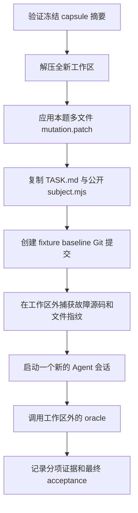

# Real-v2 进阶题：构建、验收与审计说明

本文说明新增的 12 道跨文件任务来自哪里、每题制造了什么故障、Agent 会拿到什么，以及评测器如何给出确定性的通过或失败结果。

**本文面向题库维护者，包含故障细节，不应作为受测 Agent 的任务输入。** Agent 的工作区只会获得当前题目的 `TASK.md` 和公开测试辅助文件，不会获得本文、故障补丁和隐藏断言。

## 1. 题库身份与用途

| 项目 | 当前值 |
|---|---|
| 基础 benchmark | `prale-experience-real-v2` |
| 进阶题库标识 | `real-v2-advanced-v1` |
| 当前 fixture revision | `3`，包含补充验收审计修复 |
| Oracle 协议版本 | `4` |
| 源仓库 | `earendil-works/pi` |
| 冻结提交 | `b45597504eeaba1f11a9920a1d1048c361ed4b8e` |
| 任务数量 | 3 个主题 × 4 个阶段，共 12 题 |
| 每题需要修改的生产文件 | 2–3 个；另需提交回归测试和说明 |
| 构建与验收环境 | POSIX/Linux 运行器、Python 3.12+、Node 24 |
| 自动评分依据 | 文件范围检查、可执行行为断言、回归测试的故障检测能力 |
| 是否使用 LLM judge | 否 |

这套题库位于 `evals/experience-real-v2/advanced/`，与旧的 `evals/experience-real-v2/fixtures/` 并存，旧入口的默认题目没有被替换。

它主要评测：Agent 能否调查相关模块之间的数据和控制流，在多个生产文件中修复一致性问题，并提交能复现各个故障的测试。题目仍然是**基于真实源码、人工设计的回归故障**，不是从历史 issue 自动提取的自然缺陷。

机器可读清单见 [benchmark.json](benchmark.json)，任务索引见 [TASKSET.md](TASKSET.md)，运行摘要见 [README.md](README.md)。

## 2. 源码如何冻结

基础 capsule 由 [`build_real_experience_capsule.py`](../../../scripts/build_real_experience_capsule.py) 和 [`real_experience_eval.py`](../../../scripts/real_experience_eval.py) 的 `build_capsule()` 生成。

构建器使用 `git archive <commit>` 导出已提交的代码，得到：

```text
capsules/pi-b455975/
├── source.tar
└── capsule.json
```

因此，源仓库中未提交的工作区改动不会进入 capsule。现有 manifest 固定了提交、源码包摘要与容器信息；`load_capsule()` 会检查源码包是否存在并验证 SHA-256。

当前源码包摘要为：

```text
f09a6e5e95665e63f036224a2b08b9ef139efb64735ec6001f63eb6eaa9b9575
```

12 道题都从这份快照开始。学习题修好的工作区不会成为下一题的源码基线。

## 3. 题目如何从定义生成

唯一的题目定义源是 [`build_real_experience_advanced.py`](../../../scripts/build_real_experience_advanced.py)。它定义两种数据结构：

```python
Fault(target, before, after)
Fixture(episode, stage, title, request, faults)
```

- `Fault` 指定一个生产文件中的故障变异：把正确源码片段 `before` 替换为错误片段 `after`。
- `Fixture` 指定任务的主题、阶段、事故描述，以及同时注入的多个故障。
- 每道题的故障分布在不同生产文件中，没有空补丁题。

生成器依次执行：

1. 从冻结的 `source.tar` 读取相关源码，不读取当前 pi 工作区。
2. 检查每个 `before` 在目标文件中**恰好出现一次**；源码变化导致锚点不唯一或不存在时直接报错。
3. 在内存中应用每个故障替换，使用 `difflib.unified_diff()` 生成多文件 `mutation.patch`。
4. 生成任务说明、元数据、外部 oracle 入口和公开测试辅助代码。
5. 生成题库级的 `benchmark.json`、`TASKSET.md` 和补丁格式属性文件。

这里的字符串匹配只用于**定位故障注入位置**，不用于判定修复正确性。Agent 不必提交某个指定字符串或完全相同的反向补丁。

```bash
# 重新生成题目；会写入生成文件。
python scripts/build_real_experience_advanced.py

# 只检查现有生成文件是否与定义一致；不会覆盖文件。
python scripts/build_real_experience_advanced.py --check
```

生成器目前输出 63 个文件：12 题各 5 个文件，共 60 个，再加题库 manifest、任务索引和 `.gitattributes`。README 和本文是独立维护的说明文档。

### 3.1 单题目录

```text
advanced/fixtures/session-integrity/retransfer/
├── TASK.md
├── fixture.json
├── mutation.patch
├── oracle.py
└── workspace/
    └── .prale-eval/
        └── subject.mjs
```

| 文件 | 用途 | 是否复制给 Agent |
|---|---|---|
| `TASK.md` | 当前事故、正确行为、允许修改范围与交付要求 | 是，放在工作区根目录 |
| `fixture.json` | 任务 ID、目标文件、冻结提交、版本等机器元数据 | 否 |
| `mutation.patch` | 制造初始故障 | 否；评测器先应用其效果 |
| `oracle.py` | 本题的隐藏验收入口 | 否 |
| `workspace/.prale-eval/subject.mjs` | 加载真实源码、提供可控外部边界 | 是，要求保持只读 |

### 3.2 涉及的生产模块

下文使用简称避免反复列出长路径。

| 简称 | 冻结仓库中的路径 |
|---|---|
| Resource | `packages/coding-agent/src/core/resource-loader.ts` |
| Settings | `packages/coding-agent/src/core/settings-manager.ts` |
| ProjectTrust | `packages/coding-agent/src/core/project-trust.ts` |
| Migration | `packages/coding-agent/src/migrations.ts` |
| Session | `packages/coding-agent/src/core/session-manager.ts` |
| Text | `packages/coding-agent/src/utils/text.ts` |
| DriveTools | `packages/agent/src/harness/runtime/drive/tools.ts` |
| ExecutionTools | `packages/agent/src/harness/execution/tools.ts` |
| Gate | `packages/agent/src/harness/execution/effect-gate.ts` |

另外，模块加载器还会连接真实的 `utils/paths.ts` 和 `runtime/drive/tool-placement.ts`。它们参与实际执行，但不是这 12 题中允许修改的故障目标。

## 4. 12 道题分别怎样构造与检查

每题 ID 的形式都是 `advanced/<主题>/<阶段>`。同一主题的四题共用一组隐藏行为契约，但初始故障组合不同。

### 4.1 资源一致性：`resource-consistency`

测试链路是实际的信任 resolver、资源 loader 和 SettingsManager 相互调用；设置存储与扩展发现由受控边界提供。

#### 任务 01：learn——未授权启动泄漏项目配置

同时注入三个故障：

| 文件 | 注入的错误 | 应满足的行为 |
|---|---|---|
| Resource | bootstrap 强制设置为 trusted | 即使上一状态已信任，新的 bootstrap 也必须先进入 untrusted 状态 |
| Settings | 绕过未信任项目的读取保护 | bootstrap 不得读取项目设置，也不得把它们合并进有效配置 |
| ProjectTrust | 用真假判断检查 `trustOverride` | 显式 `false` 仍是有效覆盖，必须直接拒绝而非继续默认决策 |

隐藏检查会观察实际设置存储读取、bootstrap 扩展集合、有效模型设置，以及显式 true/false 覆盖后的最终加载结果。只修 loader，仍会因 Settings 或 resolver 的独立故障失败。

#### 任务 02：transfer——记住的拒绝与配置优先级不一致

| 文件 | 注入的错误 | 应满足的行为 |
|---|---|---|
| ProjectTrust | 把已存储的 `false` 当成没有决策 | 已存储的布尔值优先于默认策略 |
| Settings | 反转全局与项目配置的合并优先级 | 信任后项目值覆盖全局值；项目未指定的嵌套字段继承全局值 |
| Resource | 最终阶段忽略批准，始终设置为 untrusted | 批准必须进入最终资源解析，拒绝必须排除项目资源 |

输入故意制造冲突：全局和项目使用不同模型、不同 `reserveTokens`，但只有全局提供 `keepRecentTokens`。验收同时检查覆盖和继承，不能只证明某个单值正确。

#### 任务 03：correction——仅本次批准不能变成永久授权

| 文件 | 注入的错误 | 应满足的行为 |
|---|---|---|
| Resource | 不调用 resolver，直接拒绝 | 在 bootstrap 后调用 resolver，恰好一次，并使用实际结果 |
| Settings | 信任状态变化时提前返回 | true/false 切换必须更新有效项目配置 |
| ProjectTrust | `remember=false` 也写入持久授权 | 只有 `remember === true` 才产生保存操作 |

验收组合测试扩展决策 yes/no 与 remember 缺失/false/true，检查项目资源是否可见及保存操作次数。批准但不记住仍可在本次会话使用；拒绝也必须生效。

#### 任务 04：retransfer——撤销必须清理资源和缓存配置

| 文件 | 注入的错误 | 应满足的行为 |
|---|---|---|
| ProjectTrust | 无 UI、无已有决策时默认批准 | ask 策略在无 UI 时拒绝 |
| Settings | 撤销时保留缓存的项目设置 | 撤销应立即清空项目配置并回到全局设置 |
| Resource | 将 resolver 的拒绝强制改成批准 | 下一次解析中项目扩展消失，全局和 CLI 扩展保留 |

验收在同一个真实 SettingsManager/loader 实例中先批准，再撤销，检查状态是否残留；另测没有 resolver 的 reload 保持现有信任状态。

### 4.2 会话完整性：`session-integrity`

测试链路使用真实迁移函数、Text/Path 工具与 Session reader，读写真实的临时文件。目录枚举顺序是明确控制的测试边界。

#### 任务 05：learn——编码和凭据优先级同时损坏

| 文件 | 注入的错误 | 应满足的行为 |
|---|---|---|
| Text | `stripBom()` 不再去除 BOM | 去除开头 BOM，保留普通文本和文本内部 BOM |
| Migration | API key 覆盖已有 OAuth 凭据 | 同 provider 的 OAuth 优先；其他 provider 可由 API key 补充 |

输入包括 BOM 编码的 `oauth.json`、BOM 编码的 settings、同名 provider、其他 provider 和无关设置字段。验收检查迁移结果、凭据内容、OAuth 输入归档、无关配置保留和重复运行；畸形输入及已有 `auth.json` 不能被破坏。

#### 任务 06：transfer——迁移写入后正常 reader 找不到

| 文件 | 注入的错误 | 应满足的行为 |
|---|---|---|
| Migration | 路径编码漏掉反斜杠 | 迁移目的地遵守约定编码 |
| Session | 路径编码漏掉冒号 | 常规查找与迁移写入使用相同目录 |

测试使用绝对 POSIX cwd，包括带反斜杠和冒号的 Windows 风格片段。它不模拟 Windows 操作系统，也不声称能在 Linux 上正确解析原始 `C:\...` cwd。

验收不是只比较目录字符串：先实际迁移，再调用 Session 的目录 API 找到文件，核对原始字节，读取有序 Unicode 记录，并检查补换行和再次读取。

#### 任务 07：correction——冲突保护与非法 header 修复

| 文件 | 注入的错误 | 应满足的行为 |
|---|---|---|
| Migration | 删除目标存在时的跳过保护 | 已有目标不可覆盖，冲突源文件也保留，后续文件继续迁移 |
| Session | header 校验由“任一非法即拒绝”变为“都非法才拒绝” | header 必须是 session 且具有字符串 ID；不合法时不能自动改写文件 |

测试准备缺少 ID、ID 类型错误、首记录类型错误的文件，要求返回空结果且字节不变；合法无换行尾记录仍应接受并修复。迁移冲突的两份文件也要保持原样。

#### 任务 08：retransfer——碰撞不能中止批次，尾记录不能丢

| 文件 | 注入的错误 | 应满足的行为 |
|---|---|---|
| Migration | 遇到碰撞 `return`，结束整个批次 | 只跳过当前文件，继续后面的迁移 |
| Session | 忽略最后没有换行符的 JSONL 记录 | 最后一条合法记录必须恰好出现一次 |

目录枚举被控制为先遇到冲突文件，再遇到可迁移文件。验收检查后者存在、完整记录顺序、Unicode 内容、重复读写和碰撞两侧的数据保留。

同主题还有防退化测试：把一个 UTF-8 中文字符刻意放在 1 MiB 读取边界两侧，检查 decoder 没有破坏字符，也没有丢掉跨缓冲区记录。

### 4.3 执行生命周期：`execution-lifecycle`

测试连接实际的恢复入口、执行与结果修订逻辑、effect gate。checkpoint 存储、进度传输和 hook 交付使用可观察的受控边界。

#### 任务 09：learn——重放授权必须一路约束到副作用

| 文件 | 注入的错误 | 应满足的行为 |
|---|---|---|
| DriveTools | 两个安全声明满足其一就重放 | 持久化策略和当前工具声明都为 safe，且未取消，才能重放 |
| ExecutionTools | 执行原始模型参数 | 必须使用恢复后清理并提供的持久参数 |
| Gate | 准入时不检查 gate 状态 | aborting/closed gate 不得开始新副作用 |

验收既直接检查 gate，也通过真实恢复执行链检查副作用是否发生。正常重放要满足清理 checkpoint、执行、封闭更新、等待进度完成、发布结果的先后关系。

#### 任务 10：transfer——实时进度、持久进度和错误不一致

| 文件 | 注入的错误 | 应满足的行为 |
|---|---|---|
| DriveTools | 没有明确 checkpoint 标志的更新也被持久化 | 只有 `checkpoint=true` 的更新持久化；普通更新和显式 false 只交付观察者 |
| ExecutionTools | 工具抛异常后标为成功 | 结果保留错误状态和错误信息 |
| Gate | signalAbort 不发送 AbortSignal | 已准入工具能观察取消信号，后续准入被拒绝 |

断言在工具调用边界之外检查观察结果。不能把本应失败的断言放进工具回调，然后被执行器当成一次正常的“工具异常输出”吞掉。

#### 任务 11：correction——允许安全恢复，正确应用显式 patch

| 文件 | 注入的错误 | 应满足的行为 |
|---|---|---|
| DriveTools | 一律禁止恢复重放 | 未取消的 safe/safe 调用仍然执行一次 |
| ExecutionTools | 用逻辑或合并 `isError` | after-tool hook 的显式 `false` 可以覆盖之前的 true |
| Gate | aborting 后不能 close | close 的终止错误应约束未来准入，不再由等待取消覆盖 |

除了显式 false 和空 content，验收也检查未指定的 details/usage 仍被保留，以及 terminate 的 true/false 修订。

此题是对条件恢复规则的进一步澄清，不代表运行器已向 Agent 注入某条错误记忆。

#### 任务 12：retransfer——取消、完成与迟到活动的边界

| 文件 | 注入的错误 | 应满足的行为 |
|---|---|---|
| DriveTools | 忽略 cancelled 标志 | 取消后不能清理 checkpoint 或调用工具，只能发布中断结果 |
| ExecutionTools | 完成后仍接受更新 | 成功或失败完成后，迟到 live/checkpoint 回调都无效 |
| Gate | beginAbort 可覆盖 closed 状态 | 已关闭 gate 不可重新打开，也不能替换既有终止错误 |

验收还使用两个独立 Promise 屏障，分别阻塞工具 effect 和进度 drain，检查发布不能提前。不会通过 sleep 时长猜测异步顺序。

## 5. Agent 运行时会得到什么

[`real_experience_eval.py`](../../../scripts/real_experience_eval.py) 的 `materialize_stage()` 和 `run_stage()` 负责准备任务。



故障补丁的效果会先提交为初始 baseline，因此初始 `git diff` 不会直接展示“哪一行刚刚被改坏”。这降低了从未提交补丁反推答案的风险，但不等同于 OS 隔离。

Oracle version 4 在 Agent 启动前，额外在工作区外保存：

- 每个目标文件的原始故障源码。
- `baseline.json`：实际普通文件的 SHA-256、符号链接目标、Git 配置摘要和 baseline commit ID。

范围判断使用这份控制器快照，不依赖 Agent 可修改的 Git index。即使 Agent 提交了 commit、修改忽略规则或使用 `assume-unchanged`，实际文件改动仍可被发现。正常提交自己的修改不会因为 HEAD 变化而失去原始基线。

## 6. Agent 必须提交什么

每题要求修改所有列出的生产文件，并创建以下产物：

```text
.prale-eval/
├── subject.mjs       # 评测器提供，不能修改
├── regression.mjs    # Agent 编写的可执行回归测试
├── result.json       # 当前阶段的结构化结果
└── repair.md         # 跨模块修复说明
```

测试命令固定为：

```bash
node --experimental-vm-modules .prale-eval/regression.mjs
```

`result.json` 示例：

```json
{
  "task_id": "advanced/session-integrity/retransfer",
  "repository": "earendil-works/pi",
  "mode": "repair",
  "validation": {
    "command": "node --experimental-vm-modules .prale-eval/regression.mjs",
    "status": "passed",
    "notes": "验证碰撞两侧文件未被覆盖，后续迁移完成，尾记录和 Unicode 内容完整。"
  }
}
```

验收会检查这些标识与元数据一致、命令完全匹配、notes 至少 20 个字符、`repair.md` 去除首尾空白后至少 80 个字符。但长度检查只是交付完整性门槛，不是对说明文档进行语义评分。

回归脚本应使用未捕获的 `node:assert/strict` 断言，不要主动 `process.exit()`、只打印成功或依赖会吞掉断言异常的测试框架。Agent 本地运行时，测试夹具、临时结果和辅助脚本应放在 `.prale-eval/` 内并清理，遵守只在工作区内写入的要求。隐藏测试自己的临时目录由控制器管理，不能据此推导 Agent 可以在工作区外写入。

## 7. 每次提交如何验收

每题都有一个 `oracle.py`，但它只是薄入口。公共流程由 [`real_experience_advanced_oracle.py`](../../../scripts/real_experience_advanced_oracle.py) 实现；三个主题的隐藏行为契约在 [`behavior.mjs`](../../../scripts/real_experience_advanced/behavior.mjs) 中。

### 7.1 第一道门：交付与修改范围

评测器检查：

1. `targets` 是至少包含两个不同路径的合法列表。
2. 每个目标文件的实际内容相对于控制器快照发生变化。
3. 除目标文件与 `.prale-eval/` 以外，没有实际新增、删除或修改的文件/符号链接。
4. 根 Git 配置没有改变。
5. 必需文件存在且不是符号链接，公开 `subject.mjs` 与控制器版本逐字节相同。
6. 结果标识、验证命令和交付说明满足要求。

改了多个文件本身不证明正确；这些条件通过后仍必须运行行为测试。只往各文件加注释，不能修复其实际行为。

### 7.2 第二道门：隐藏行为契约

评测器复制最终工作区，在副本上加载提交的完整 TypeScript 模块并执行所属主题的全部断言。

- Node 的 `stripTypeScriptTypes()` 去除类型，然后由 VM 模块执行实际代码。
- 属于加载清单的本地模块连接彼此的真实实现。
- Node 标准库提供实际文件、路径、解码和 AbortController 行为。
- 其他边界提供受控输入，或在发生未预期调用时抛错。

这一步是运行时行为校验，不是完整 TypeScript 类型检查，也不是执行整个 pi 构建。

### 7.3 第三道门：提交测试在修复版通过

在一个新的副本上执行 Agent 的同一份 `regression.mjs`，要求正常完成并退出 0。隐藏测试和提交测试不共享工作区，提交测试不能依赖隐藏测试留下的文件。

### 7.4 第四道门：逐文件恢复故障

假设一题修改 A、B、C 三个生产文件，构造以下副本：

| 条件 | A | B | C | 同一份提交测试应得到 |
|---|---|---|---|---|
| 修复版 | 修复 | 修复 | 修复 | 通过 |
| 独立故障 A | 本题原始故障 | 修复 | 修复 | 断言失败 |
| 独立故障 B | 修复 | 本题原始故障 | 修复 | 断言失败 |
| 独立故障 C | 修复 | 修复 | 本题原始故障 | 断言失败 |
| 完整故障 | 本题原始故障 | 本题原始故障 | 本题原始故障 | 断言失败 |

两文件题使用对应的四行条件：修复、A 故障、B 故障、全部故障。

每个副本都从原提交单独复制，不会继承上一个测试写入的内容；不复制 `.git` 和 `node_modules`。各副本采用相同的 `workspace` 目录名和无条件标签的随机父目录，不能用 `fault-0` 等目录名猜测验收条件。

这里恢复的是**整个目标文件的原始故障版本**，不是强行给任意新代码套某一行错误补丁。因此任务要求保持已有 API。跨文件重构如果改变了这些文件间的接口，使原始文件无法与其余修复文件一起加载，会被判失败；这套协议不适合任意 API 重构任务。

### 7.5 什么才算有效的负向证据

[`regression.mjs`](../../../scripts/real_experience_contracts/regression.mjs) 控制器包装器负责分类：

| 现象 | 判定 |
|---|---|
| 修复版脚本正常完成，退出 0 | 正向条件通过 |
| 故障版产生真正的、未捕获的 Node `AssertionError` | 包装器记为 42，并输出断言标记；负向条件通过 |
| 普通 Error 只是伪装成 `name=AssertionError` / `code=ERR_ASSERTION` | 拒绝 |
| 手动打印标记并调用 `process.exit(42)` | 拒绝 |
| 提前 `process.exit(0)` 跳过检查 | 拒绝 |
| 语法、导入、运行环境错误或超时 | 拒绝，不能算检出故障 |
| 只打印 success，所有条件都退出 0 | 拒绝，无法检出故障 |
| 所有条件都无条件 assert.fail | 拒绝，修复版不能通过 |

断言分类标记放在错误诊断之后，避免大段错误输出截断时丢掉标记。隐藏行为测试也通过控制器包装执行，防止提前退出伪装成完成。

### 7.6 通过条件

只有下面条件全部满足才设置 `acceptance="passed"`：

```text
Agent 进程成功结束
AND 交付与修改范围通过
AND 隐藏跨模块行为契约通过
AND 提交回归测试在修复版通过
AND 提交测试检出每个文件的独立故障
AND 提交测试检出完整原始故障
```

检查按顺序执行，失败后会停止，不保证失败报告中出现所有后续检查字段。

## 8. 哪些是真实执行，哪些是 fake

| 链路 | 真实执行 | 受控边界 / fake |
|---|---|---|
| 资源一致性 | resolver、loader、SettingsManager 的解析、合并、信任切换和扩展集合处理 | 设置存储、信任事件输入、UI 选择、资源发现和扩展实例加载 |
| 会话完整性 | Migration、Text、Path、Session reader、真实临时文件、真实 UTF-8 解码 | agentDir 定位；Migration 的目录枚举按固定顺序提供 |
| 执行生命周期 | 恢复条件、工具执行、结果修订、effect gate、工具来源映射、中断结果格式化 | checkpoint 读写、进度传输、hook 返回值、测试工具函数 |

公共加载器见 [`subject.mjs`](../../../scripts/real_experience_advanced/subject.mjs)。它为恢复模块追加一个访问私有恢复入口和绑定外部边界的导出，不替换被评测的恢复条件、executor 或 gate。

每次恢复测试调用使用独立模块图，避免并发运行时串用 checkpoint、progress 或 publication。未知的外部调用会报错，不会默默返回正确答案。Node 内置模块导出保留完整 namespace，支持合法的 named、default 和 namespace import 用法。

## 9. 确定性来自哪里

- 输入数据、provider 名称、会话 ID 和预期状态固定。
- 新工作区、副本和 HOME/TMPDIR 隔离前一次测试的文件状态。
- 碰撞场景明确控制目录顺序，不假定真实文件系统总按文件名字典序枚举。
- 字符跨 1 MiB 边界的位置按 UTF-8 字节数计算，不靠近似字符串长度。
- 异步验证使用 Promise 屏障，在 effect 或 drain 被允许完成前检查是否提前发布。
- 事件顺序既检查事件存在且恰好发生一次，再比较位置，避免 `indexOf()` 返回 -1 时误通过。
- 不以随机目录名、真实时间戳或外部服务响应决定正确性。随机目录只用于隔离和隐藏条件。

每个 Node 子进程上限 8 秒；外层 oracle 默认上限 60 秒。超时用于终止死循环或挂起，不用于推断异步逻辑正确。源码评估另有 VM 的同步执行时限。

运行环境只传入必要的 PATH、HOME、TMPDIR 和 CI，不继承模型密钥或 NODE_OPTIONS。报告中的 stdout、stderr 分别保留末尾最多 20,000 个字符。

## 10. 如何证明题目和验收器自身有效

对应的语料测试是 [`test_real_experience_advanced.py`](../../../tests/unit/test_real_experience_advanced.py)。它与 Agent 的提交测试不是同一回事。

### 10.1 枚举所有故障文件组合

对一题有 k 个独立故障文件，语料测试枚举全部 `2^k` 种状态：

- 没有故障：原始正确实现必须通过。
- 留有任何一个或多个故障：隐藏行为契约必须触发断言失败。

当前共有 8 道三文件题和 4 道两文件题：

```text
8 × 2^3 + 4 × 2^2 = 80 个源码状态
其中 12 个健康状态，68 个非空故障状态。
```

这检查“只修 A 不修 B”“只剩 C 错误”等部分修复是否会被漏掉。**枚举全部组合是题库维护时的自检；每次 Agent 提交不重跑所有组合，而采用第 7 节的固定、逐文件和完整故障回放。**

### 10.2 验收器与辅助代码的测试

测试还覆盖：

- 全部 12 题的修复、逐文件故障和完整故障验收。
- 只覆盖一个故障文件的回归测试不能通过。
- 未改完源码、越界文件、旧任务标识、篡改 helper、空测试被拒绝。
- 等价布尔表达式和合法 namespace import 被接受，不依赖固定源码写法。
- 缺失 / null 重放策略保持不安全；并发测试调用互不串状态。
- 普通错误、直接退出、大段诊断输出的分类。
- Git 隐藏改动、Git 配置改动和控制器目录名推断被识别。
- 宿主文件枚举顺序反转时，碰撞 fixture 仍按定义触发故障。
- 额外的非题目原始变异：未知策略被放行、缺少 drain、patch 丢失 usage，仍被行为测试检出。
- 三个主题各一次完整 capsule 解压、确定性修复器提交、外部 oracle 的端到端流程。

参考回归脚本独立编写在测试中，仅使用公开 helper，没有导入隐藏断言。端到端测试使用确定性修复脚本，不调用真实模型，不能被当成真实 Agent 的成绩。

## 11. 本轮审计发现与修复

fixture revision 2 纳入以下修复，并保留对应的回归测试：

| 问题 | 可能后果 | 修复 |
|---|---|---|
| 内置模块只暴露解析到的少数导出 | 合法 namespace import 被误拒 | 暴露完整内置模块 namespace |
| `persisted ?? 'safe'` 将缺失策略变安全 | fake 掩盖恢复保护错误 | 区分未提供选项与明确的 undefined/null；扩展到 32 个准入组合 |
| 多个 run 复用模块级边界绑定 | 并发时结果发布到另一测试 | 每次运行创建独立模块图与边界 |
| 按错误的 name/code 或手动退出判定 | 普通异常、伪造退出被算作故障断言 | 检查真正 AssertionError，阻止直接退出 |
| 分类标记在长错误信息之前 | 合法断言被输出截断误拒 | 标记放到诊断最后 |
| 修改范围只依赖 Git diff/index | assume-unchanged 隐藏越界改动 | 控制器提前捕获真实文件指纹和 Git 配置摘要 |
| 目录名含 fixed/fault 等条件标签 | 测试无需看源码就能猜条件 | 各条件采用同名随机工作区 |
| 假定宿主目录枚举顺序 | 碰撞题偶发不触发 | 明确控制 Migration 枚举顺序 |
| 只比较事件位置、不验证事件存在 | 缺失事件的 -1 位置误通过 | 检查次数、存在性和严格顺序 |
| 只检查完整 patch、未检查字段继承 | 丢失未指定 usage/details 可能漏检 | 增加局部 patch、terminate 和字段保留测试 |
| 工具内部断言可能被捕获成工具错误 | 测试自身的失败被吞掉 | 在调用边界外断言实际观察结果 |
| 路径题对 Windows 范围描述过宽 | 正确实现面对歧义要求 | 明确为 POSIX 运行器上的路径片段编码，不声称 Windows OS 集成 |

这些修复提高了检测可靠性，但不构成对恶意代码的完整防作弊证明。

## 12. 运行与复验

以下命令从 PRALE 仓库根目录运行。

### 12.1 本地题库自检，不调用模型

```bash
python scripts/build_real_experience_advanced.py --check
python -m pytest tests/unit/test_real_experience_advanced.py
```

检查公共运行器兼容性可增加旧 real-v2 和 crossrepo 的相关测试。代码检查可使用：

```bash
python -m ruff check \
  scripts/build_real_experience_advanced.py \
  scripts/real_experience_advanced_oracle.py \
  scripts/real_experience_oracle.py \
  scripts/real_experience_eval.py \
  tests/unit/test_real_experience_advanced.py

python -m mypy --follow-imports skip --check-untyped-defs \
  scripts/build_real_experience_advanced.py \
  scripts/real_experience_advanced_oracle.py \
  scripts/real_experience_oracle.py \
  scripts/real_experience_eval.py
```

### 12.2 真实 Agent 的 warm/cold 对照

```bash
python scripts/run_real_experience_batch.py \
  --capsule evals/experience-real-v2/capsules/pi-b455975/capsule.json \
  --fixtures evals/experience-real-v2/advanced/fixtures \
  --adapter prale --memory-mode warm \
  --state-dir .eval-state/advanced-warm-r2 \
  --output reports/advanced-warm-r2.json \
  --allow-host-execution
```

cold 使用 `--memory-mode cold` 和另一组 state/output 路径。Claude Code 使用 `--adapter claude-code`；其状态保留方式按适配器实际实现解释，不能把复用 HOME 自动等同于已验证的原生记忆实验。

真实模型需要单独配置 endpoint、模型和凭据。以上批量命令可能产生模型费用；本地题库自检不会。

四阶段共用同一驱动方式，区别来自任务内容、故障组合和执行顺序。PRALE warm 保留长期记忆，cold 不启用长期记忆；当前批量入口没有在 transfer 冻结记忆，也没有在 correction 专门改写记忆。

## 13. 如何读取结果

单个阶段结果的主要结构如下，示例省略具体输出内容：

```json
{
  "agent_status": "completed",
  "acceptance": "passed",
  "files_changed": ["..."],
  "oracle_result": {
    "oracle_version": 4,
    "fixture_revision": 3,
    "suite_id": "real-v2-advanced-v1",
    "task_id": "advanced/session-integrity/retransfer",
    "status": "passed",
    "checks": {
      "behavior": {"status": "completed", "exit_code": 0},
      "regression_fixed": {"status": "completed", "exit_code": 0},
      "regression_individual": {
        "packages/coding-agent/src/migrations.ts": {"status": "completed", "exit_code": 42},
        "packages/coding-agent/src/core/session-manager.ts": {"status": "completed", "exit_code": 42}
      },
      "regression_combined": {"status": "completed", "exit_code": 42}
    }
  }
}
```

`agent_status` 只表示执行进程状态；`acceptance` 才是这一题的最终判定。报告会保留各分项的状态、退出码与输出，失败时还可能包含 `error`。源码摘要、suite、revision、模型配置和实际运行环境应一同保留，不能混合不同版本的成绩。

## 14. 能保证什么，不能保证什么

本轮全量复验共有 187 项测试通过，其中进阶题库 119 项，原 real-v2 和相关 crossrepo 流程 68 项；这不是模型成绩。后续仅调整了参考测试输入的临时目录和文档，并进行对应的局部复验。

当前自检证明的是：原始正确实现通过，定义的每个故障及全部故障子集会失败；提交测试必须区分修复与原始故障；已复现的验收器缺陷有回归覆盖。

它不证明以下结论：

- 任意输入、任意等价重构都正确；这是一组有限行为契约。
- 完整 pi 应用构建、所有 SDK 验证、真实数据库事务和进程崩溃恢复均正确。
- 回归脚本一定采用了理想的测试方法；变异敏感性不能替代对恶意实现的审查。
- Node VM、临时目录或 cleared environment 是 OS sandbox；正式运行仍需现有容器和出口隔离策略。
- correction 一定纠正过某条真实旧记忆，或 warm 的改进必然来自长期记忆。
- 这些题目的实际难度和模型区分度已经被真实模型实验测量。

因此，报告应把“题库与验收自检通过”“真实模型任务通过率”“记忆增益实验”分开记录。完整协议及设计决策见 [real-v2-behavioral-acceptance.md](../../../specs/real-v2-behavioral-acceptance.md)。

## 2026-11-09 补充审计

当前 revision 3 的范围指纹已加入权限位，共享实现位于 `scripts/real_experience_manifest.py`；默认信任策略增加独立分支检查，代理进程组在验收前清理。最新问题与复验见 [审计报告](../AUDIT_REPORT.md)。上文 revision 2 的问题和 187 项统计为历史记录。
