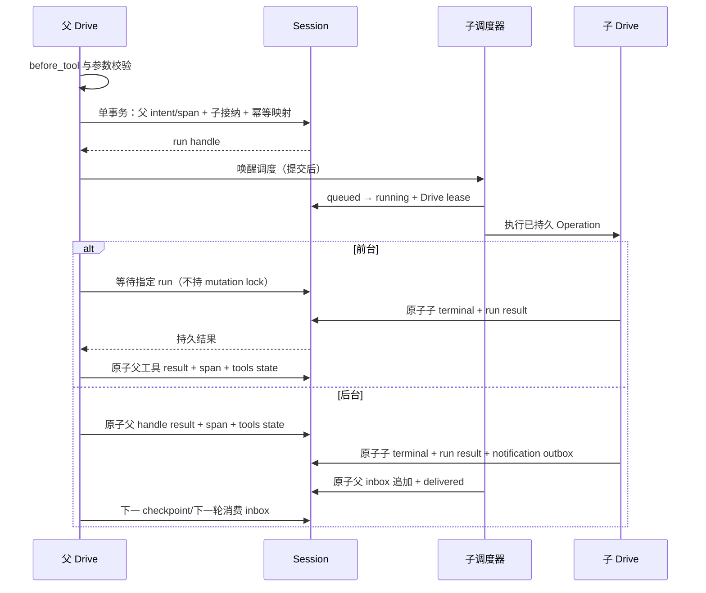

# Python Subagent 系统实现方案

状态：首版已实现（2026-10-04）。本文记录已交付的 Python library/runtime 契约与验收范围。

本方案遵守 [Harness 实施规范](AGENTS.md) 与 [主实施方案](pi-harness-implementation-plan.md)。术语以 [CONTEXT.md](../CONTEXT.md) 为准；“必须”表示验收条件。设计参考本地 Claude Code 源码，兼容目标是行为与可恢复性，不是 TypeScript 文件组织、UI 或 provider wire payload。

## 1. 目标、范围与参考

首版交付 provider-neutral Python library/runtime：专用 agent 定义、独立任务上下文、受限工具集合、前台等待、后台执行、查询/等待/停止、续跑、结果通知与崩溃恢复。接入现有部署配置、supervisor 和事件流，不新增专用 Web 页面或 HTTP 管理路由。

首版不包含团队协作、agent 间通信、嵌套委派、父历史 fork、worktree/远程隔离、完整权限审批及 agent 专属 MCP/插件加载。工具集合限制不等于文件系统或进程沙箱。

### 1.1 参考行为与适配

以下路径均来自 `/root/vibe/cc/claudeCode/src/`，链接指向本次设计实际检查的源码。路径与符号是来源定位，不是实现依赖。

| 来源 | 已检查的行为 | PRALE 决策 |
|---|---|---|
| [AgentTool.tsx](/root/vibe/cc/claudeCode/src/tools/AgentTool/AgentTool.tsx:80) 的 input/output schema 与 call | prompt、类型、model、前台/后台以及完成/启动结果 | 保留核心输入；返回持久 agent/run handle，不用 output file 作为结果权威 |
| [loadAgentsDir.ts](/root/vibe/cc/claudeCode/src/tools/AgentTool/loadAgentsDir.ts) 与 [builtInAgents.ts](/root/vibe/cc/claudeCode/src/tools/AgentTool/builtInAgents.ts) | Markdown/frontmatter、自定义与内置定义、工具/模型/轮次配置 | Python DTO + 显式目录加载；冻结配置；不复制全局自动发现、插件或实验开关 |
| [runAgent.ts](/root/vibe/cc/claudeCode/src/tools/AgentTool/runAgent.ts:248) 的 runAgent | 子上下文、专用 system prompt、query loop、sidechain transcript | 子 lane 从空历史开始；generation intent、entries 与 Operation 是权威 |
| [agentToolUtils.ts](/root/vibe/cc/claudeCode/src/tools/AgentTool/agentToolUtils.ts:70) 的 filterToolsForAgent/resolveAgentTools | 工具过滤与禁止递归 | 父级能力交集；子级移除全部 subagent 控制工具；runtime 再次防护 |
| [LocalAgentTask.tsx](/root/vibe/cc/claudeCode/src/tasks/LocalAgentTask/LocalAgentTask.tsx:466) 的 registerAsyncAgent 与 enqueueAgentNotification | 后台任务、取消、完成通知 | durable run state + terminal outbox，不依靠进程内 task map |
| [agentToolUtils.ts](/root/vibe/cc/claudeCode/src/tools/AgentTool/agentToolUtils.ts:508) 的 runAsyncAgentLifecycle | 先完成任务，再通知调用者 | 子终态和通知 outbox 原子提交，随后异步投递 |
| [resumeAgent.ts](/root/vibe/cc/claudeCode/src/tools/AgentTool/resumeAgent.ts:42) | 根据 agent ID 恢复历史并继续 | 同身份/子 lane 接纳新 Operation；不回退到另一 agent 定义或工作目录 |
| [TaskOutputTool.tsx](/root/vibe/cc/claudeCode/src/tools/TaskOutputTool/TaskOutputTool.tsx) 与 [TaskStopTool.ts](/root/vibe/cc/claudeCode/src/tools/TaskStopTool/TaskStopTool.ts) | 查询、阻塞等待、超时与停止 | 专用 run 查询/等待/停止，等待超时不取消运行 |
| [forkSubagent.ts](/root/vibe/cc/claudeCode/src/tools/AgentTool/forkSubagent.ts:107) | fork 历史中补全未完成 tool-use、缓存前缀及递归防护 | 首版不复制历史，不伪造父工具结果；防护依据持久身份 |

参考实现的 React/AppState、AbortController、转录文件及进程内通知均不能替代 PRALE 的持久恢复点。参考 Explore 提示允许受约束的 Bash，但 PRALE 尚无命令鉴权；首版 Explore/Plan 必须直接移除 `bash`。

### 1.2 实现前基础与扩展原因

实现前的 Harness 支持多 lane 和 fork，但没有父子执行身份或生命周期。普通 AgentTool 仅接收 arguments；Drive 按 safe/never 恢复普通工具，不知道子运行关联。SessionMutator 只允许一次 commit，不能在 mutation 中调用会再次 mutate 的 Lane.prompt/attach。现有 inbox 只接受用户 prompt；Operation terminal 写入尚不包含子运行结果。

因此必须新增原生控制调用、可组合的接纳/结算写入构造和类型化 inbox，而不是通过普通工具闭包启动 asyncio task，再用完成事件补写数据库。

## 2. 领域、架构与接口

### 2.1 领域关系与边界

```text
Session（一个写拥有者）
  ├─ 父 Lane → 父 Operation → subagent 控制调用
  └─ Subagent（agent_id，固定 owner_parent_lane）
       ├─ 内部 Lane（独立历史）
       └─ SubagentRun × N（每次一个子 run Operation）
            └─ result / 后台 notification
```

一个 Subagent 对应一个保留名称 `__subagent__/<agent_id>` 的内部 lane；一个 SubagentRun 对应一个子 `kind="run"` Operation。agent_id、run_id、operation_id 分开分配。每次续跑生成新 run/Operation，旧结果永不改写。每个身份同时最多一个非终态 run。

内部 lane 仍进入 Session lane 索引，供恢复与已授权观察；普通 acquire/prompt/navigate/fork 和 Web 写接口必须拒绝保留名称。只读观察可显示 `internal=true` 与 agent/run 关联。runtime 创建内部 lane 使用独立入口，不通过字符串名称赋予能力。首版只能由原 owner_parent_lane 续跑与管理该身份；公共调用同样验证归属。

模块职责：domain 定义不可变 DTO、地址、状态转换及校验；runtime 负责原生控制 dispatcher、子调度、provider 解析协议和恢复；storage 保持通用 value/list/entry 事务；integrations 加载文件定义并组装具体 provider/tool；api 暴露 facade 与领域错误。不得让 domain 导入 runtime、provider SDK、YAML 或 Web。

### 2.2 定义与加载

`SubagentDefinition` 使用 frozen dataclass，字段为 `name: str`、`description: str`、`system_prompt: str`、`tools: tuple[str, ...] | None`、`disallowed_tools: tuple[str, ...]`、`model: str | None`、`max_turns: int = 50`、`background: bool = False`。None model 表示继承父 provider。未指定 tools 表示父工具集合；`["*"]` 等价于未指定，但不能和具体工具混用。

名称为非空 ASCII 字母/数字/连字符/下划线；工具匹配使用精确注册名。prompt/description 必须非空；轮次为正整数且不接受 bool。无效/重复字段、未知字段、未知工具与未知 provider 标识在装配阶段拒绝；已知但父级未启用的工具仅从运行能力交集中移除。

内置 `general-purpose` 使用通用任务提示和父级可用工具；`explore` 与 `plan` 仅允许 `read`、`repository_explore`、`memory_search`、`conversation_search`、`memory_read_scene`、`skill_load`，再取父级交集。只读类型不得开放 bash/write/edit，即使自定义同名定义使用 tools wildcard，也必须继续取只读能力交集；提示文本从 PRALE 实际工具定义生成，不承诺未注册工具。

文件定义使用 UTF-8 Markdown，YAML frontmatter 字段为 `name`、`description`、`tools`、`disallowed_tools`、`model`、`max_turns`、`background`，正文映射为 system_prompt。使用安全 YAML 解析并拒绝重复键；PyYAML 作为可选 `subagents` extra，只有文件加载器导入。Python DTO 与内置定义不要求安装 YAML。

仅扫描显式配置目录的直接子文件 `*.md`，按文件名排序；不递归、不自动发现 `.claude/agents` 或用户目录。同名自定义定义报错，Python/文件之间也不得静默覆盖；唯一允许的覆盖是自定义同名定义替换内置定义。加载在部署装配时完成，不热更新。

```markdown
---
name: code-reviewer
description: 分析代码风险并返回报告
tools: [read, repository_explore]
model: inherit
max_turns: 30
background: false
---
根据任务提供的范围检查代码，报告证据、影响和建议。不要修改文件。
```

`inherit` 规范化为 None。定义文件不能配置 permission mode、cwd、hooks、MCP、shell command 或新 provider。接纳时冻结完整定义、规范 JSON 的 SHA-256 哈希、实际工具能力上限和 resolved provider ID；恢复/续跑不重新读取文件定义。

### 2.3 公共 API

`Harness.open` 增加可选 keyword-only definitions、subagent_config、provider_resolver；默认开启子运行功能与恢复；library 模型工具仍显式注册。新增 facade 方法：

```python
await harness.start_subagent(
    parent_lane: str, parent_operation_id: str,
    request: SubagentRequest, idempotency_key: str,
) -> SubagentAdmission
await harness.continue_subagent(
    agent_id: str, parent_lane: str, parent_operation_id: str,
    prompt: str, background: bool, idempotency_key: str,
) -> SubagentAdmission
await harness.get_subagent_run(run_id: str) -> SubagentSnapshot
await harness.list_subagent_runs(parent_lane: str) -> tuple[SubagentSnapshot, ...]
await harness.wait_subagent_run(run_id: str, timeout_ms: int = 30_000) -> SubagentWaitResult
await harness.stop_subagent_run(run_id: str) -> SubagentStopResult
await harness.recover_subagents() -> SubagentRecoveryReport
```

以上为接口签名示意，不是可直接执行的 Python。start/continue 验证父 Operation 属于父 lane 且未终态/取消；接纳立即返回，前台是否等待由调用者或模型控制 dispatcher 决定。查询/等待/停止仍由持有该 Session facade 的已授权调用者发起。公共 API 使用同样的归属与禁止子级委派检查，不提供绕过能力限制的入口。

DTO：Request 包含任务工具对应字段；Admission 包含 agent_id/run_id/operation_id/background；Snapshot 包含身份、父关联、description、状态、开始/结束时间与可选 Result；Result 包含 Operation status、最终回答 excerpt、answer_entry_id、terminal_tip_id、截断标记与 error_code；WaitResult 区分 ready/timeout；StopResult 区分新请求/已请求/已终态。时间与 ID 通过现有可注入 lane context 提供。

明确领域错误：`SubagentsDisabled`、`UnknownSubagentType`、`UnknownSubagentRun`、`SubagentBusy`、`InvalidSubagentDefinition`、`SubagentCapacityExceeded`、`SubagentOwnershipError`、`SubagentCapabilityUnavailable`、`SubagentIdempotencyConflict`。存储缺失/交叉引用矛盾属于持久状态损坏，不能解释为普通未知任务。

### 2.4 模型控制工具

| 工具 | 输入 | 行为 |
|---|---|---|
| `subagent` | prompt、description；可选 subagent_type、context、model、max_turns、run_in_background | 默认 general-purpose；前台返回终态，后台返回 admission handle |
| `subagent_continue` | agent_id、prompt、run_in_background=False | 在已终态身份的历史上创建新 run |
| `subagent_output` | run_id、block=True、timeout_ms=30000 | 返回终态或当前快照；timeout 范围 0..600000 ms |
| `subagent_list` | 空对象 | 列出当前父 lane 的所有 run，按接纳顺序 |
| `subagent_stop` | run_id | 请求停止，返回 stop DTO，不等待取消全部收束 |

模型不可提供 session、父身份、父 Operation、tool-call ID、cwd、scope 或 idempotency_key；这些由 Drive 注入。block=False 时立即查询，timeout=0 等价于立即查询。run_in_background 省略时使用定义 background；显式参数优先。模型 max_turns 只能降低定义限制。

子失败/unknown 作为 `is_error=true, terminate=false` 的结构化父工具结果返回，父级可分析或重试新任务；hook 阻止沿用现有 hook-blocked 终止语义。结果默认至多 4096 tokens，使用现有 token 估算/截断设施；完整回答留在子 entry，空回答为合法空字符串，绝不以原始 transcript 替代最终回答。

### 2.5 调用示例

下例为已交付 API 的使用方式，假定 harness 已显式启用 subagents 并注入 provider resolver，父 lane 已接纳尚未终态的 Operation；不要求应用启动 HTTP 服务。

```python
parent = await harness.acquire_lane("main")
parent_admission = await parent.prompt("分析存储层的恢复风险")
child = await harness.start_subagent(
    parent_lane="main",
    parent_operation_id=parent_admission.operation_id,
    request=SubagentRequest(
        prompt="检查存储层事务和恢复边界，返回带源码引用的报告。",
        description="检查存储恢复",
        subagent_type="explore",
        context="重点关注 intent 后、settlement 前进程退出的情形。",
        run_in_background=True,
    ),
    idempotency_key="storage-recovery-review-v1",
)
current = await harness.get_subagent_run(child.run_id)
finished = await harness.wait_subagent_run(child.run_id, timeout_ms=30_000)
# finished.retrieval_status 为 ready 或 timeout；超时不会停止运行。
# 需要停止时显式调用 await harness.stop_subagent_run(child.run_id)。
```

模型后台调用和回执的内容示例（外层仍使用现有 ToolExecutionResult）：

```json
{
  "name": "subagent",
  "arguments": {
    "prompt": "分析存储恢复风险并返回报告。",
    "description": "检查存储恢复",
    "subagent_type": "explore",
    "run_in_background": true
  }
}
```

```json
{
  "status": "accepted",
  "agent_id": "agent-1",
  "run_id": "run-1",
  "operation_id": "operation-child-1",
  "background": true
}
```

此处 accepted 是控制工具回执类型，不是 SubagentRun 的持久状态；实际 run 仍可处于 queued、running 或 terminal。前台工具回执 status=terminal，携带相同身份与 Result；output 回执携带 retrieval_status=ready/timeout/not_ready 和 Snapshot，block=False 且未终态时为 not_ready。

## 3. 持久化与状态机

### 3.1 权威记录与格式

新增记录全部为明确 JSON DTO，带 `format_version=1`；不增加 `$type` 标签，不新增 SQL 表或 migration。meta 写入一次，state 整体替换，result 仅终态写一次。lists 只追加或整体清除；投递状态另存 value，禁止修改 list 中已有元素。

| 地址 | 内容与规则 |
|---|---|
| `subagent/<agent_id>/meta` | owner_parent_lane、内部 lane、完整定义快照/hash、provider ID、原始工具能力上限 |
| `subagent/<agent_id>/state` | current_run_id、last_run_id；终态与续跑接纳时原子更新 |
| `subagent-run/<run_id>/meta` | agent_id、child_operation_id、parent_lane/operation_id、origin_tool_call_id（API 可为空）、任务/背景、模式、实际能力、接纳时间、输入 hash |
| `subagent-run/<run_id>/state` | queued/running/terminal、cancel_requested、持久轮次计数、可选错误 |
| `subagent-run/<run_id>/result` | 不可变结果；与子 Operation terminal 同事务 |
| `session/subagent_runs`、`subagent/<agent_id>/runs`、`operation/<parent_id>/subagent_runs` | 按接纳顺序追加 run_id；仅作枚举索引 |
| `subagent/request/<key_hash>` | 父 lane/Operation 命名空间内的请求映射、原 key 与请求 hash、agent/run ID |
| `subagent/notification_outbox` | 后台终态 notification_id/run_id/owner lane 的只追加记录 |
| `subagent/notification/<notification_id>/state` | pending/delivered；delivered 带父 inbox entry_id |

内部 lane/Operation 同时使用现有 lane_state/tip/operations 与 operation_meta/state/result/lease。hash key 包含 Session、父 lane、父 Operation 和调用者幂等键；模型键固定为 tool-call ID。重复键且输入相同返回原 Admission，即使 run 已终态；不同输入抛 conflict。

无这些地址的旧 Session 解释为空集合；未知 format version fail-closed，不修复或重建用户数据。新版本读取旧普通工具 Operation 行为不变。旧程序无法识别新控制调用状态，因此不保证包含未终结子运行 Session 的降级运行；回滚前必须收束子运行或使用独立数据副本。

### 3.2 状态转换与事务

| 当前状态 | 触发 | 下一状态 | 同事务必须写入 |
|---|---|---|---|
| 不存在 | 合法新请求 | queued | 父控制 intent/span（模型调用）、请求映射、身份/lane、子 Operation 接纳、run 与全部索引 |
| queued | 子调度取得 Drive 执行权 | running | run state 与子 Operation lease；不在提交前执行 provider/tool |
| queued | 显式 stop 或父 abort | terminal/aborted | 子 Operation result/state、lane state、agent state、run result、后台 outbox；无外部 effect |
| running | 生成/工具推进 | running | 沿用现有 intent/effect/settlement；轮次分配与生成 intent 同事务 |
| running | 显式 stop 或父 abort | running + cancel_requested | 子 Operation control 与 run 取消标记；先关闭 effect gate，再提交，再中止本地任务 |
| running | 子 Operation terminal | terminal | 原 terminal 全部 writes + run result/state + agent state + 后台 outbox |
| terminal | 显式 continue | 原 run 保持 terminal，新 run queued | 新请求映射、Operation/run/index、agent current_run；复用子 lane tip |

terminal 状态携带 existing OperationStatus：completed/declined/aborted/failed/unknown。未知结果不能编码为 completed 或永久 running。SubagentRun 不增加新的 OperationKind，也不重定义普通 safe/never replay_policy。

### 3.3 原生控制调用

新增描述性 `RuntimeControlTool` 协议：name/description/input_schema/max_result_tokens 与 control_kind，和普通 AgentTool 共用模型 ToolDefinition 投影，但执行路径分开。ToolRegistry 必须区分 ordinary/control，普通 execute_parallel 不得执行控制工具。dispatcher 与 Subagent runtime 通过 runtime 内协议协作，不引入 api → runtime 的反向依赖。

Drive 的 `before_tool` 仍先运行，后重新校验 hook 修改过的 arguments。父身份来自持久 Operation/lane 绑定，hook 输出不能修改身份或工具控制类型。全部通过后，单次 Session.mutate 构造并提交 §3.2 的接纳写入；必须抽取现有 Lane 接纳写入构造，不能在 mutation 内递归调用 attach/prompt，也不能先启动子 task 后持久化。

父 `OperationState.at` 保持 tools；对应 call 增加 versioned `control` 数据：kind、validated_request、agent_id/run_id、phase（waiting/receipt_ready/completed）、等待 deadline（output 工具）、预留 result_entry_id。原 tools 状态的普通 call 格式保持兼容。

前台 admission phase=waiting，等待原 run；后台 admission phase=receipt_ready，原 Admission 即可结算父结果。恢复先识别 control 数据，不进入普通 safe/never 分支；重复接纳查询同一请求映射，不创建新 run。等待 deadline 在父 intent 中冻结，恢复不得重新给予完整超时时间；截止已过时返回快照。

output/list 为安全读，结果和父 call settlement 同事务；stop 的取消写入与控制 intent 同事务，恢复读取已有取消/终态返回；不得在重放时重新停止该身份的新 run。参数一律指定 run，停止与等待不追随 agent 的 current_run。

含控制工具的批次沿 assistant 源顺序拆分：普通并行段沿用既有并行机制，控制调用为串行边界。多个后台 subagent 依次接纳后可并发运行。父工具结果 entry 顺序始终与源调用一致。

### 3.4 终态与 span

必须将子 run terminal 写入构造并入现有 Operation settlement transaction，覆盖正常结束、before_drive 拒绝、turn limit、取消、provider/tool 失败和 unknown 恢复全部出口。事件监听器、task done callback、独立补写事务都不能生成权威结果。异常退出但尚未 terminal 的 Drive 保留持久状态供恢复，并报告 supervisor failure。

子最终回答取该 run 已结算的最后 assistant 正文；同时保存 answer_entry_id 与 terminal_tip_id。无正文不伪造成功答案。span、usage 和回答仅使用已提交事实。

父控制 span 记录本次接纳/等待结果，不包含子 token。后台 span 以 handle 返回时完成；前台 span 等待子终态再完成。恢复挂接同一控制调用不发出第二个外部 effect，继续结算原 span；普通子 LLM/tool span 沿用既有 interrupted/unknown 规则。取消后父控制 span 收束为 aborted，不遗留 pending；子 span 由子 Operation 恢复收束。

## 4. 执行、权限与生命周期

### 4.1 独立上下文与 provider

子 lane 从空 tip 开始，仅装配冻结 agent system_prompt、当前任务与显式 context。context 作为用户提供的任务资料，不能作为 system 指令或授权；不复制父消息、未完成工具调用或父记忆投影。续跑保留子历史并追加新任务。system prompt 在每次 generation 投影时装配，随后完整进入 intent；恢复不得从变动文件重建。

provider resolver 协议只接收注册 ID 并返回 ChatProvider；具体 SDK 与凭据留在 integrations。模型优先级为调用覆盖、定义 model、父 provider ID；未知 ID 在接纳前拒绝。启动时冻结解析 ID，恢复缺失 provider 时报告 capability unavailable，禁止静默切换模型。

子 context management 使用父配置，但在独立历史上执行。scope 和长期资产 runtime 与父一致；文件/命令工具实例使用父部署 cwd，agent 定义及调用参数均不可修改。

### 4.2 能力收缩与归属

有效工具为部署注册集合 ∩ 父当前工具集合 ∩ 定义允许集合，再减去定义禁止集合与全部五个 subagent 控制工具。接纳冻结上限；恢复和续跑只与当前部署/父级能力再次取交集，不能因新注册工具扩大旧身份上限。启动身份只能在 owner_parent_lane 管理，模型只能查询该父 lane 的 runs。

对 malformed/direct API 请求使用持久身份禁止子级委派，不能仅移除模型 schema。子所有普通工具继续走 before_tool，事件额外携带 lane/operation_id/agent_id/run_id/parent_lane/parent_operation_id；原 tool_call_id/tool_name/arguments 字段保留。hook 不得直接写 Session；阻止和异常遵守原 fail-closed 语义。

恢复中已撤销工具：未执行调用以 capability_unavailable 失败并收束；已有 pending safe effect 先按现有规则结算失去的 attempt 为 unknown，再拒绝新 attempt；never 保持 unknown，不重放。不可用 provider 不驱动新 effect，结果/停止查询仍可使用。

本方案不新增命令授权、路径授权或人工审批等待状态。使用 Bash 的 general-purpose 仍拥有父级已允许的进程能力；explore/plan 移除 Bash 的限制才是 runtime 实际可执行的只读约束。

### 4.3 调度与预算

SubagentConfig 默认 enabled=True、每 Session max_running=4、max_nonterminal=64、max_result_tokens=4096。非终态计数包含 queued/running；超限在原子接纳校验时拒绝，不占半个记录。调度按 run 接纳顺序公平取得子槽，排队不持有 lane Drive lease。

runtime 持有强引用的子 asyncio tasks；任务不是权威。一个子 Operation 至多一个 Drive。子运行状态与 lease 领取在同一 Session transaction 更新；同进程重复 recover 必须先检查现有 task，不能抢占活跃 lease。执行完释放槽并唤醒下一 queued run。

子槽与 Web 父 Drive 上限分开；等待子的父 Drive 不占子槽。父写请求的 Web 限流仍维持原契约，监控分别展示父 active_drives、子 active/queued。配置 max_running=1 时必须能完成前台委派，不能出现父占全部槽再等待子的死锁。任何等待不得持有 Session mutation lock。

max_turns 默认 50，取定义与请求较小值。assistant generation intent 首次创建时同事务增加 run 持久 turn 计数；provider retry 复用同一 turn，context summary 不计入。完成当前轮工具后，下次准备生成前若计数已达限制，以 failed/turn_limit_exceeded 收束；保留已执行结果，不截断某个工具批次。没有工具的正常回答即使恰好达到上限仍正常完成。

### 4.4 等待、停止、续跑与关闭

调用方断开、取消 wait coroutine 或 wait 超时，只终止等待；独立 task 通过 shield/通知等待保护，不能沿 awaited task 传播取消。显式 stop 关闭指定 run 的新 effect gate，持久化 cancel_requested 后 cancel 本地任务；重复 stop 返回已有状态。

父 request_abort 必须在同一 mutation 中标记父 Operation 及该父 Operation 关联的全部非终态子 runs；前台/后台一律级联。effect gate 与 Session admission 串行协调，避免 abort 与新子接纳竞争产生漏取消。queued run 直接 aborted；running run 由已有取消/恢复出口收束。父普通失败/正常完成不级联停止后台 run。

后台任务的父归属属于接纳它的 Operation，不追随父 lane 下一轮：取消下一轮不能停止上一轮存活的子运行，需显式 stop。续跑绑定发起续跑的新父 Operation；原 run 取消不能影响新 run。身份忙时 continue 返回 SubagentBusy，不作为 steer 入队。

completed/declined/failed/aborted/unknown 均允许显式 continue。unknown/aborted 后仅从已结算子历史继续，新 prompt 不重放旧工具；新的 run 有独立预算。继续时保持原定义、provider 标识及能力上限，不回退到 general-purpose。

Harness/部署关闭先禁止接纳，停止调度，再 cancel 并 join 本地子 Drive，然后关闭 Session storage；关闭任务不是用户 abort，不写新的 cancel_requested，也不假称远端 effect 已取消。打开的 Session 再次挂载时先执行恢复，再允许接纳；launcher 依现有 catalog 打开 Session，不扫描任意 DB 路径。

## 5. 后台通知、恢复与集成

### 5.1 通知协议

只有后台 run 终态追加 outbox；notification_id 固定由 run_id 派生。outbox 内容是持久结果引用，正文以不可变 run result 为准。dispatcher 在一个 mutation 内读取 pending、AppendList 父 lane inbox 并 SetValue delivered；并发/重复投递先验证状态，不重复追加。不能在投递完成前标 delivered。

inbox 新增 kind=subagent_notification，保留旧未带 kind 的 prompt 条目兼容。消费时使用冻结 entry_id，在同一 transaction 追加父 message entry、更新 tip 并清除已消费 inbox；消费输出为用户角色的数据消息，payload 保留 notification/run/agent/source Operation ID，正文使用固定包裹格式明确这是子任务结果资料。不得作为 system prompt 注入。

父执行中在下一 checkpoint 消费；父 idle 时等待下一 prompt/显式 drive，通知本身不接纳新 Operation。父取消时未消费通知保留，供下一轮或查询读取。output/wait 查询不标 delivered，不消费通知。前台结果只经原工具结算，不生成额外通知。

通知正文和普通工具结果都使用 4096-token excerpt + answer_entry_id，完整子历史不复制到父 branch。下一轮读取结果不构成授权。

### 5.2 时序



### 5.3 恢复矩阵

恢复只从 Session 权威记录和索引重建身份/运行，验证每个索引引用的 meta/state/result/Operation/lane。缺失或矛盾必须报告 incomplete durable state，不能扫描 trace 猜结果，也不能从子 Operation 单独补出漏写的 run terminal。

| 中断点 | 恢复行为 |
|---|---|
| 接纳事务未提交 | 父调用仍 planned，无子记录；重新校验并接纳 |
| 接纳已提交、task 尚未创建 | 从 queued 与请求映射启动同一 run；不重复接纳 |
| lease 已领、effect 尚未发出 | 清除失效进程 lease，恢复该 Operation；当前活跃 Drive 不得被抢占 |
| 子 LLM intent 后或响应未结算 | 沿原 LLM recovery 明确 interrupted/unknown，不续接 HTTP 流 |
| 子 safe tool outcome 未结算 | 沿原 replay_policy 尝试恢复；丢失 attempt 先结算 unknown |
| 子 never tool outcome 未结算 | 写 unknown 结果并收束；不自动执行第二次 |
| 子 terminal 已提交、父前台未结算 | 读取同一 run result，结算原父 tool-call/result_entry_id |
| 后台接纳已提交、父 handle 未结算 | 返回同一 Admission，即使子已终态；结果仍经后台通知交付 |
| outbox pending | 重试投递，按 notification state 去重 |
| inbox delivered、尚未消费 | 不重复投递，下一 checkpoint 只追加一次 message |
| cancel_requested 已提交、本地 task 未停止 | 先恢复取消，不再启动新的 provider/tool effect |

recover_subagents 重建 queued/running 调度并完成 pending 通知投递，返回 recovered、queued、terminal、unavailable、incomplete 分类报告；不可用 provider 留下可查询状态，不伪造成功。原有单 lane recover 遇到原生控制 call 转入同一 dispatcher，不执行普通工具重放。若某个恢复步骤失败，其他独立 run 可继续恢复，但明确报告失败。

### 5.4 部署、资产与可观测性

`PRALE_TOOLS` 支持五个控制工具；未配置该变量时默认使用这五个工具，显式列表（包括空字符串）完全替代默认集合。新增 `PRALE_SUBAGENTS_ENABLED=true`、`PRALE_SUBAGENT_MAX_RUNNING=4`、`PRALE_SUBAGENT_MAX_NONTERMINAL=64`、`PRALE_SUBAGENT_MAX_RESULT_TOKENS=4096`；`PRALE_SUBAGENT_DIRS` 为 JSON 字符串数组，默认 `[]`，相对目录按 project_root 解析。配置控制工具但未启用 subagents 报错；关闭 runtime 且未配置工具时默认空集合。library 启用 runtime 本身不暴露模型工具，Python facade 不依赖模型 allow-list。

默认 provider resolver 仅注册现有父 provider；多模型由部署注入已注册 ChatProvider 映射，不引入新 provider SDK。文件目录配置需安装 subagents extra，缺依赖在 durable 打开前报配置错误。

子 terminal 继续沿现有 memory/Skill outbox 归档，使用子 Operation base/terminal tip 增量，不重复捕获父历史。scope 保持父值；归档格式补充 agent/run/父关联但不引入独立资产所有者。父答案可包含子报告引用，不把同一子 usage 重记到父账本。

事件包括 subagent_admitted/started/terminal、subagent_notification_delivered；均在对应 commit 后发布。generation/tool/Operation 遥测增加 agent_id/run_id/parent_operation_id/parent_tool_call_id；缺失引用时保持未知。父子聚合按 Operation ID 去重，遥测失败不阻塞持久 settlement。记录当前 active/queued、终态分类、排队时间与 capability-unavailable，禁止依赖这些指标进行恢复。

部署 supervisor 必须持有/关闭每个打开 Session 的子 runtime；不会通过通用 Web lane 接口启动内部 lane。不新增无限后台线程、独立 SQLite 写连接或跨 Session 原子事务。

## 6. 实施顺序与验收

每阶段先写 conformance/integration/crash-recovery 测试，再实现；没有必要将纯文档变更扩展为代码重构。

| 子阶段 | 交付 | 验收 |
|---|---|---|
| 11.1 领域与接纳 | DTO/JSON/version/地址、身份、可组合 lane admission、幂等索引 | memory/SQLite 同一套原子接纳、回滚、重复请求与冲突测试 |
| 11.2 定义与能力 | 内置角色、Python/Markdown loader、provider resolver、能力冻结 | 加载失败在接纳前；只读和归属防护不可绕过 |
| 11.3 前台运行 | 控制协议/dispatcher、独立 generation、调度与终态扩展、turn budget | 前台结果、失败传播、max_running=1、源序落盘与不重复创建 |
| 11.4 后台与恢复 | 通知/inbox、query/wait/stop/continue、级联取消、shutdown/recovery | 每个持久转换和副作用边界故障注入通过 |
| 11.5 部署与观察 | 配置/allow-list、supervisor、事件/telemetry、资产关联和 API 示例 | 默认开启与显式关闭、工具集合覆盖均有测试；退出无本地 task/process 泄漏；结果可跨进程查询 |

### 6.1 测试清单

- Unit：定义字段/重复 YAML 键/未知工具/provider；同名规则；能力交集；DTO/JSON round-trip；token 截断；预算边界。
- Conformance（memory 与 SQLite 参数化同套）：父子接纳 all-or-nothing；提交失败无半记录；同请求复用/冲突；run 与 Operation terminal 原子一致；索引不可作为权威；通知投递与 inbox 原子性；版本拒绝与旧 Session 兼容。
- Integration：独立历史不携父未完成工具；专用 system prompt 进入 intent；context 无授权；hook 重新校验；子控制工具移除和 direct API 递归拒绝；内部 lane 写入口禁止；源序结果；空答案合法；失败不默认终止父级。
- 调度/预算：并发 4、FIFO queued、非终态上限 64、max_running=1 前台无死锁；queued 不占 Drive lease；重复 recover 无第二 Drive；retry 不重复 turn；达到 turn limit 保留工具结果。
- 生命周期：断开/超时不取消 run；queued stop、running stop、重复 stop；父前台/后台级联；取消下一父轮不影响上一轮子；完成/停止/接纳竞争只一终态；continue 忙拒绝、旧结果可查、unknown 不重放副作用。
- 通知：每 run 一条；terminal/outbox、outbox/inbox、inbox/entry 各原子；query 不消费；父 idle 不调用模型；父取消后通知可在下一轮消费；普通 prompt inbox 兼容。
- Crash recovery：至少覆盖 §5.3 每一行，尤其 intent 后、effect 后、settlement 前；模拟真实进程退出后 SQLite 重开，验证 spans 不遗留假 pending/伪造耗时或 usage；同进程活跃 task 不被 recover 抢占。
- 集成回归：子 memory/Skill 增量与归属正确；父子 usage 不重复；遥测/监听器故障不改变结果；显式关闭所有原行为一致；shutdown join 完成后 storage 才关闭。

### 6.2 检查与完成标准

实现阶段运行受影响 pytest、`ruff check`、`ruff format --check`、mypy（包含新领域/API/storage 代码，新增 runtime 也明确纳入类型检查）。修改 Drive、取消或 terminal 后运行完整 integration/crash_recovery/conformance suites；其他阶段只运行相关 suites，失败后修复再验证。

首版完成必须证明：子执行前已有 durable intent；父子关联不会重复创建；每项状态转换都有验收测试；终态/span/usage/通知事务一致；关闭或崩溃不丢已接纳运行；never 不重放；子级不能扩大父能力；通知不会主动启动父模型。若实现发现需改变 API、状态格式或恢复语义，先同步本文与主方案 ADR，不能在代码里留下未记录的分支行为。


### 6.3 已交付实现与验证入口

- `domain/subagents.py` 定义不可变 DTO、领域错误、内置角色和版本化记录；`api/subagents.py` 保持稳定公开导出。`OperationResult` 的权威定义位于 `domain/operations.py`，原 `api.models` 导入路径继续重导出，序列化 discriminator 不变。
- `runtime/subagents.py` 管理原子接纳、能力冻结、provider registry、FIFO 调度、续跑、取消、通知与恢复。`runtime/lane.py` 提供 admission/terminal writes，`runtime/drive.py` 分派五个原生控制工具并处理源序结算。Harness 的 ID 与时间源可注入。
- `integrations/subagent_definitions.py` 仅加载显式目录中的 Markdown；重复 YAML 键和未知字段拒绝。部署 Settings、serve 与 Web supervisor 已接入启用开关、唯一工具 allow-list、生命周期和活动/排队指标；trace 标注内部 lane 与 agent/run 关联。
- 子接纳在独立历史追加 `subagent_run_admitted` custom entry，包含父子身份。memory/Skill outbox 同时携带关联字段，L0 增量直接保存该 entry，无需更改资产数据库 schema。
- 取消结算给所有尚未配对的 planned/pending 调用按源序追加 tool result，并关闭已发出效果的 span；远端效果无法确认时保留 unknown，子 run 不伪装完成。普通工具 intent 保存接纳时的 replay_policy；旧 intent 缺少此字段时兼容既有工具注册策略。
- Unit：`tests/unit/test_subagent_definitions.py`；memory/SQLite 原子性：`tests/conformance/test_subagent_storage.py`；完整生命周期与五工具部署：`tests/integration/test_subagents.py`、`test_subagent_deployment.py`。
- 真实进程退出恢复：`tests/crash_recovery/test_subagent_recovery.py`。覆盖 queued、父控制 intent、子 LLM intent、tool planned/effect、子 terminal、父 result、通知 delivered/consumed 和 cancel_requested；safe/never 分别断言重放次数，撤销工具后拒绝恢复效果。损坏 run 的通知不能阻止其他合法 run 交付。

公开 Python 用法与部署配置见 [README](../README.md)。首版没有添加审批系统或进程沙箱；只读角色和子工具交集是本方案规定的能力边界。
